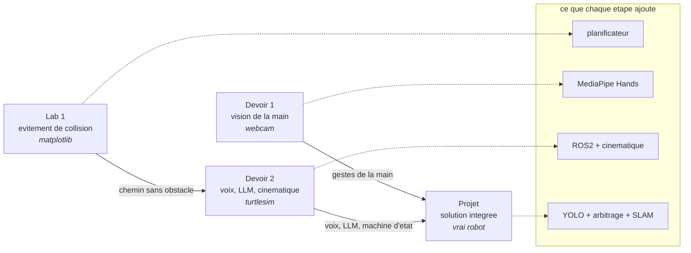
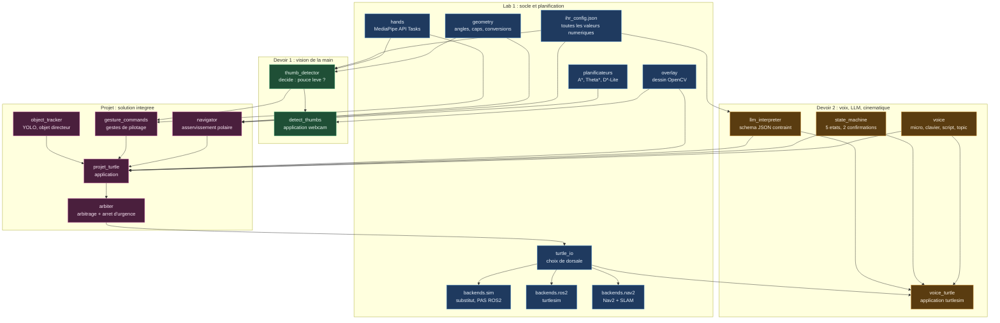
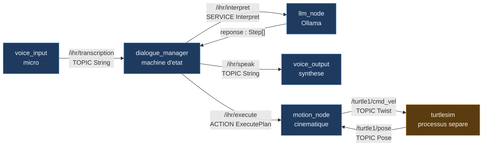

# 6MIG841 : Interaction humain-robot : énoncé global du laboratoire

Ce document est l'énoncé d'ensemble. Il dit **ce que chaque travail ajoute**, sur quel
support, avec quelles librairies, et ce qui en est volontairement absent. Chaque
répertoire de travail porte ensuite son propre énoncé détaillé.

La logique de la session est une **croissance de complexité**. Au début, un triangle se
déplace sur une grille. À la fin, un vrai robot obéit à la voix, voit son environnement et
choisit lui-même quelle modalité écouter.

---

## La progression, en une figure



---

## L'architecture : ce que chaque travail expose et consomme

Les flèches sont des **importations réelles**, non des dépendances conceptuelles. Un module
du Projet qui recopierait le code du Devoir 1 au lieu de l'importer casserait ce graphe.



Trois lectures utiles sur cette figure.

**Le socle du Lab 1 n'importe rien.** Il est au sommet et tout en dépend. C'est ce qui permet
de le tester seul, sans caméra, sans micro, sans ROS2.

**`turtle_io` est le seul chemin vers le robot.** Les trois dorsales sont derrière lui, et
l'arbitre du Projet passe par lui. C'est délibéré : un second chemin de commande serait un
second endroit où l'arrêt d'urgence peut être oublié.

**Le Projet n'ajoute que quatre modules**, et trois d'entre eux ne font que **décider** :
`gesture_commands`, `navigator`, `arbiter`. Le seul qui perçoive est `object_tracker`. Tout
le reste vient des travaux précédents, par importation.

---

## Le tableau d'ensemble

| | **Lab 1** | **Devoir 1** | **Devoir 2** | **Projet** |
| --- | --- | --- | --- | --- |
| **Sujet** | évitement de collision | vision de la main | voix, LLM, cinématique | solution intégrée et fonctionnelle |
| **Support** | application matplotlib autonome, produite par le harnais Aider | webcam | **turtlesim**, six nœuds ROS2 en parallèle | vrai robot |
| **Communication** | aucune, un seul processus | aucune | **topic, service et action**, les trois modes de ROS2 | les trois, plus les actions Nav2 |
| **Vision** | aucune | **MediaPipe Hands**, API Tasks, 21 points de repère | aucune | MediaPipe (gestes, repris du Devoir 1) **+ YOLO** (objets) |
| **Mouvement** | le triangle se téléporte d'un point de passage au suivant | aucun | **cinématique** : profils de vitesse sur la linéaire et l'angulaire, trajectoires en arc | tout le précédent, plus l'arbitrage des modalités |
| **Planification** | **A\*, puis Theta\*, puis D\*-Lite**, trois paliers comparés sur la même grille | aucune | aucune : tourner puis avancer | Nav2 et SLAM sur carte |
| **Librairies ajoutées** | `matplotlib`, `numpy`. Et la préparation du `.venv` **pour les trois travaux suivants** | `opencv-python`, `mediapipe` | `rclpy`, `geometry_msgs`, `turtlesim`, `ollama`, `faster-whisper` (reconnaissance vocale locale), `SpeechRecognition` (capture audio brute), `PyAudio`, `pyttsx3` | `ultralytics` (YOLO), `navigation2`, `slam_toolbox` |
| **Absent volontairement** | ROS2, cinématique, dynamique, vision | le robot, ROS2 | la dynamique, la vision, l'évitement (l'obstacle y est fixe et arrête la tortue, il n'est jamais contourné) | rien |

---

## Ce que chaque travail apporte, et pourquoi dans cet ordre

### Lab 1 : l'évitement de collision, sans cinématique

Trois choses, dont une seule est le sujet.

**Préparer les librairies** de tous les travaux : un environnement Python isolé, des
versions figées et mesurées, les deux modèles de vision téléchargés. Cela sert au Devoir 1,
au Devoir 2 et au Projet, donc c'est fait une fois, ici.

**Le harnais Aider**, pour coder avec un modèle de langue local. Son manuel vit dans
`C:\Users\m3otis\.config\aider\MANUAL.md` ; le tutoriel du Lab 1 y renvoie plutôt que de le
recopier.

**Et le sujet : l'évitement de collision.** Une grille, un obstacle, un point de départ, un
but. Le planificateur rend une suite de points de passage, et le triangle les parcourt en
s'y **téléportant**. Aucune cinématique, aucune dynamique : on ne juge ici que le chemin.

C'est délibéré. Un chemin correct et un mouvement correct sont deux problèmes, et les
mêler rend l'échec illisible.

#### Les trois paliers de planification

Le Lab 1 ne livre pas un planificateur, il en livre **trois**, et chacun est motivé par une
limite du précédent que vous devez **mesurer**, pas croire.

| Palier | Planificateur | Ce qu'il apporte | La limite qu'il laisse |
| --- | --- | --- | --- |
| 1 | **A\*** | le chemin le plus court sur la grille | un escalier, le chemin suivant les arêtes des cellules, donc multiplie les changements de direction |
| 2 | **Theta\*** | un test de ligne de vue, donc des segments à angle libre et beaucoup moins de points de passage | il replanifie tout dès qu'un obstacle apparaît |
| 3 | **D\*-Lite** | la replanification **incrémentale**, qui réutilise le calcul précédent | aucune |

Les trois tournent sur la **même** grille, le même obstacle, les mêmes départ et but, et
sont comparés sur trois grandeurs : longueur du chemin, nombre de points de passage, et coût
de replanification quand l'obstacle bouge.

Le deuxième palier est celui qui compte pour la suite. Chaque changement de direction est une
rotation, et sur un vrai robot chaque rotation ajoute de la dérive d'odométrie. Un chemin en
escalier est donc plus coûteux qu'il n'en a l'air, et c'est au Projet que vous en paierez le
prix.

> **Le harnais Aider n'est pas modifié.** Son jeu de plans d'exemple sert de modèle de
> forme ; les jeux de plans des trois planificateurs sont écrits dans ce dépôt, pas dans
> `~/.config/aider`.

### Devoir 1 : la vision de la main

La webcam, MediaPipe Hands, 21 points de repère par main, et une décision : ce geste est-il
un pouce levé ? Aucun robot. La sortie est un compteur affiché.

La difficulté n'est pas d'obtenir les points, c'est de **décider** avec eux. Une décision
qui dépend de la distance à la caméra ou de l'inclinaison de la main n'est pas une
décision, c'est une coïncidence.

### Devoir 2 : la voix, la LLM, et la cinématique

Trois ajouts en même temps, sur **turtlesim**, la démonstration canonique de ROS.

**La voix** : reconnaissance vocale, puis synthèse pour répondre.

**La LLM**, locale, qui traduit une phrase française en action. Pas en nombres libres : en
un choix parmi un catalogue fermé, contraint par un schéma. Le modèle **classe**, il ne
calcule pas.

**La machine d'état** qui organise le dialogue, avec deux confirmations distinctes, ai-je
bien *entendu*, et la LLM a-t-elle bien *traduit*.

**Et la cinématique**, qui est la croissance de complexité sur le robot. Le Lab 1 se
téléportait ; ici, la tortue suit un profil de vitesse. Conséquence à découvrir par
l'expérience : dès qu'on commande la vitesse linéaire et la vitesse angulaire en même
temps, la trajectoire est un **arc**, pas un segment. Un arc peut entrer dans un obstacle
que le segment évitait.

**Et un obstacle, désormais réel.** Ce mécanisme de refus existe depuis la cinématique,
mais rien en production n'en déclarait un avant le 2026-09-19 : la tortue ne pouvait donc
jamais heurter quoi que ce soit, et la leçon ci-dessus ne se voyait que dans un test. Le
Devoir 2 porte maintenant un obstacle **fixe**, une seconde tortue immobile engendrée par
`devoir2.launch.py` à la position que la grille de planification du Lab 1 désigne
(`devoir2.obstacle`, convertie en unités turtlesim par `Lab1/code/planif/world.py`) : une
commande simple peut se voir refusée, l'instant et la position de la collision prévue
nommés dans le journal. Sans évitement : contourner l'obstacle reste le rôle de Nav2, au
Projet.

#### Six nœuds, et non un programme

C'est ici que le Devoir 2 cesse d'être un script qui parle à ROS2, et devient un **système
ROS2**. Six nœuds indépendants, tous parallèles, chacun avec son propre exécuteur.



**Les trois modes de communication de ROS2 sont utilisés, chacun là où il se justifie.**

| Mode | Où | Pourquoi celui-là |
| --- | --- | --- |
| **topic** | transcription, parole, `cmd_vel`, `pose` | flux continu, sans réponse attendue, plusieurs abonnés possibles |
| **service** | interprétation par la LLM | c'est une requête-réponse : une phrase entre, des étapes sortent. Un topic obligerait à apparier la réponse à la demande à la main |
| **action** | exécution du mouvement | long, annulable, avec avancement. L'arrêt d'urgence devient un `cancel_goal`, et non une priorité inventée |

Aucun des dix-neuf rapports des promotions précédentes n'utilise de service ni d'action. Tous
publient des topics, et tous tiennent dans un seul fichier. C'est le principal écart de
niveau que ce devoir vous demande de franchir.

**Ce que le découpage vous donne gratuitement**, et qu'un programme monolithique ne peut pas
avoir :

- `ros2 topic echo /ihr/transcription` montre ce que le micro a compris, sans toucher au code ;
- `ros2 bag record -a` enregistre une séance entière, et la rejoue sans micro ni caméra ;
- la fenêtre de turtlesim ne dépend plus de votre programme, puisque c'est un autre processus ;
- l'appel à la LLM, qui bloque une à deux secondes, ne gèle plus l'écoute ;
- `voice_input` peut tourner sur un portable et `motion_node` sur le robot, sans une ligne de
  changement. C'est DDS qui s'en occupe.

**`voice_input` ouvre sa propre petite fenêtre**, sous ROS2 aussi bien pour le Devoir 2 que
pour le Projet qui l'hérite sans changement : le journal entrelacé de six nœuds ne peut pas
afficher un texte qui se réécrit pendant que vous parlez, et sous `ros2 launch`, aucun nœud ne
reçoit le clavier du terminal (`stdin`). C'est cette fenêtre qui affiche la transcription au
fur et à mesure et qui capte votre **Entrée**, jamais le terminal.

**Et un seul lancement, malgré les six nœuds :**

```powershell
stDev2.bat
stDev2.bat input:=micro domain_id:=12
```

Le fichier `devoir2.launch.py` démarre les six, turtlesim compris, et `ros2 launch` entrelace
leurs sorties dans le même terminal, préfixées par le nom du nœud. C'est votre journal de
débogage, et il est gratuit. `input:=clavier` (saisie tapée plutôt que parlée) ne fonctionne
que **hors** `ros2 launch`, faute de `stdin` rattaché sous le launch ; sous `stDev2.bat`,
utilisez `input:=micro` ou le défaut `auto`.

### Projet : la solution intégrée

Tout ce qui précède, plus deux ajouts.

**YOLO**, pour la vision d'objet. MediaPipe reconnaît une main ; YOLO reconnaît un
téléphone, une fourchette, une banane. C'est la deuxième couche de vision, et elle donne au
robot une cible dans le monde plutôt qu'un geste.

**L'arbitrage.** Le geste, la voix et l'objet commandent tous les trois, parfois en même
temps. Il faut décider laquelle écouter, le dire à l'écran, et réserver la priorité absolue
à l'arrêt d'urgence. Une main ouverte devant la caméra arrête le robot, et cet arrêt ne
passe par aucun modèle de langue.

Puis le vrai robot, avec SLAM pour bâtir la carte et Nav2 pour y naviguer.

---

## Ce qui circule d'un travail à l'autre

Rien n'est recopié. Chaque travail **importe** ce que le précédent a produit.

| Produit par | Réutilisé par | Sous quelle forme |
| --- | --- | --- |
| Lab 1 | les trois autres | l'environnement Python et les modèles |
| Lab 1 | Devoir 2, Projet | la notion de chemin et de points de passage |
| Devoir 1 | Projet | la décision sur les gestes de la main |
| Devoir 2 | Projet | la voix, la LLM, la machine d'état |

Un travail qui recopie le code d'un autre au lieu de l'importer sera repris : la
duplication est ce qui fait diverger deux versions en silence.

---

## Les deux réflexes à garder toute la session

**On vérifie l'effet, jamais l'annonce.** Mesuré sur la machine de l'enseignant en
septembre 2026 : `pip` a rendu le code de succès **0** après avoir affiché
`No matching distribution found`, et `wsl --install` a rendu **0** après un échec
d'enregistrement de distribution. Un script qui teste le code de retour conclut donc à la
réussite. On lit l'état, pas le code.

**Un dépôt public n'est pas une garantie.** Toujours mesuré en septembre 2026 : les quatre
programmes rendus par les promotions précédentes s'arrêtent tous sur
`AttributeError: module 'mediapipe' has no attribute 'solutions'` avant leur première
trame, l'API qu'ils utilisent ayant été retirée depuis leur remise. Ce n'est pas leur
faute, et c'est exactement ce qui arrivera à votre code dans deux ans.

---

## Environnement de la session

| Élément | Valeur |
| --- | --- |
| Système | Windows 11 |
| Python des travaux 1 et 2 | 3.13, dans `.venv` à la racine |
| Python de ROS2 | 3.12, dans l'environnement conda `ihr` |
| ROS2 | Humble, par conda et le canal `robostack-humble` |
| LLM local | Ollama |

ROS2 sur Windows passe par conda, sans WSL, sans Docker et sans droits administrateur.
La procédure exacte est dans le tutoriel du Lab 1.
