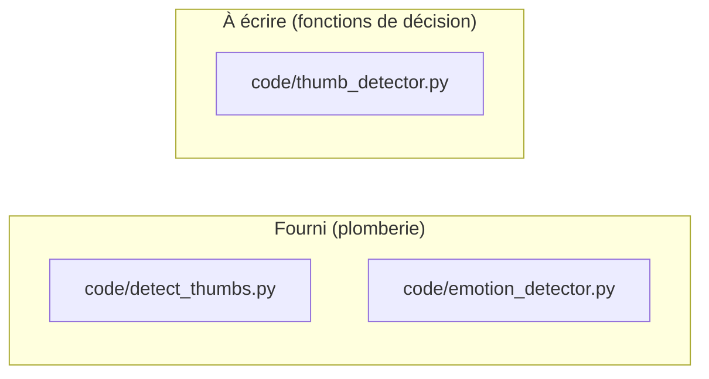
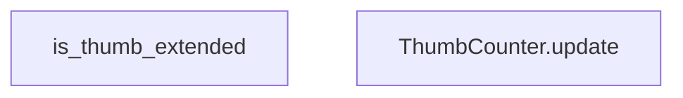

# Énoncé - Devoir1

## Objectif

Détecter combien de mains lèvent le pouce dans une trame webcam, de façon stable d'une image à l'autre.

## Prérequis

- L'environnement .venv est actif (racine du dépôt).
- mediapipe, opencv-python et numpy sont installés dans .venv.
- Lab1/code/models/hand_landmarker.task est présent (recréé par ihr_ros.hands.ensure_model).

Vérifier l'environnement :

```
.\.venv\Scripts\python.exe Lab1\code\check_env.py
```

## Architecture : fourni contre à écrire



## Fonctions à implémenter

| Fonction | Fichier | Indice | Tests |
| --- | --- | --- | --- |
| `ThumbCounter.update` | `code/thumb_detector.py` | ajouter a l'historique puis publier seulement quand la fenetre est unanime | `test_valeur_repetee_window_fois_est_publiee`, `test_valeurs_alternees_ne_publient_jamais` |
| `is_thumb_extended` | `code/thumb_detector.py` | comparer les trois distances au poignet dans l'ordre MCP, IP, TIP | `test_verdict_des_cinq_mains_canoniques`, `test_pouce_leve_reste_valide_quelle_que_soit_lechelle` |

## Logigramme des fonctions et de leurs appels

L'ordre d'implémentation se lit sur la figure : traiter les feuilles (aucune flèche sortante) avant les fonctions qui les appellent.



## Marche à suivre

1. Lancer la suite de tests du travail et lire la liste des échecs.
2. Choisir une FEUILLE du logigramme ci-dessus (un nœud sans flèche sortante) : une
   fonction qui n'en appelle aucune autre parmi celles à implémenter se termine toujours
   en premier, avant celles qui en dépendent.
3. Ouvrir le fichier source à l'endroit indiqué, lire le docstring complet (Purpose,
   Inputs, Outputs) : c'est le contrat exact à respecter.
4. Lire les tests cités pour cette fonction : ils donnent les cas concrets attendus.
5. Écrire l'implémentation, à l'indentation déjà en place.
6. Relancer la suite et itérer jusqu'à ce que CETTE fonction seule passe tous ses tests.
7. Remonter au nœud suivant du logigramme, jusqu'à ce que la suite complète soit verte.

## Pièges connus

- Un seuil exprimé en coordonnées normalisées (0 à 1) dépend de la distance de la main à la caméra : une main proche et une main loin ne franchissent pas le même seuil en pixels.
- Comparer directement deux ordonnées pour juger un pouce levé suppose la main verticale à l'écran ; une main inclinée inverse le résultat.
- Un compteur de pouces levés qui n'est pas filtré dans le temps clignote d'une trame à l'autre dès qu'une détection hésite.

## Résultats attendus

- La suite Devoir1/test passe intégralement.
- Devant la webcam, le compte de pouces levés affiché reste stable même quand la détection MediaPipe hésite une trame sur deux.

## Contenu du rapport

| Section | Points |
| --- | --- |
| Introduction et contexte | 8 |
| Bibliothèques utilisées | 7 |
| Méthode utilisée | 15 |
| Schéma bloc de la solution | 10 |
| Logigramme des fonctions | 15 |
| Explications du code | 10 |
| Tests du programme | 15 |
| Résultats et mesures | 10 |
| Discussion et limites | 5 |
| Conclusion | 3 |
| Références et hygiène | 2 |
| **Total** | **100** |
