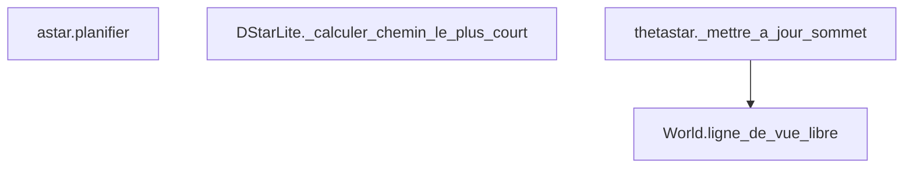

# Énoncé - Lab1

## Objectif

Planifier un chemin sans collision sur une grille, avec trois planificateurs de complexité croissante.

## Prérequis

- L'environnement .venv est actif (racine du dépôt).
- numpy et matplotlib sont installés dans .venv.

Vérifier l'environnement :

```
.\.venv\Scripts\python.exe Lab1\code\check_env.py
```

## Architecture : fourni contre à écrire

```mermaid
flowchart LR
    subgraph Fourni["Fourni (plomberie)"]
        F0["code/check_env.py"]
        F1["code/extract_libs.py"]
        F2["code/ihr_ros/__init__.py"]
        F3["code/ihr_ros/backends/__init__.py"]
        F4["code/ihr_ros/backends/base.py"]
        F5["code/ihr_ros/backends/nav2.py"]
        F6["code/ihr_ros/backends/ros2.py"]
        F7["code/ihr_ros/backends/sim.py"]
        F8["code/ihr_ros/config.py"]
        F9["code/ihr_ros/face.py"]
        F10["code/ihr_ros/geometry.py"]
        F11["code/ihr_ros/hands.py"]
        F12["code/ihr_ros/overlay.py"]
        F13["code/ihr_ros/turtle_io.py"]
        F14["code/planif/__init__.py"]
        F15["code/planif/app.py"]
        F16["code/planif/compare.py"]
        F17["code/planif/vue.py"]
    end
    subgraph AEcrire["À écrire (fonctions de décision)"]
        E0["code/planif/astar.py"]
        E1["code/planif/dstarlite.py"]
        E2["code/planif/thetastar.py"]
        E3["code/planif/world.py"]
    end
```



## Fonctions à implémenter

| Fonction | Fichier | Indice | Tests |
| --- | --- | --- | --- |
| `astar.planifier` | `code/planif/astar.py` | tas priorise par cout f = cout_venu + heuristique, fermer avant d'expandre | `test_chemin_en_ligne_droite_sans_obstacle_ne_fait_aucun_detour`, `test_obstacle_contourne_le_chemin_existe_et_s_allonge`, `test_arrivee_enfermee_ne_rend_rien` |
| `DStarLite._calculer_chemin_le_plus_court` | `code/planif/dstarlite.py` | depiler tant que la cle du sommet est inferieure a celle du depart, propager g/rhs aux voisins potentiels | `test_moins_de_cellules_reexaminees_qu_une_replanification_complete`, `test_premier_calcul_dstarlite_egale_la_longueur_d_astar` |
| `thetastar._mettre_a_jour_sommet` | `code/planif/thetastar.py` | regle de Nash et al. : si le grand-parent voit voisine en ligne directe, rattacher au grand-parent plutot qu'a actuelle | `test_thetastar_a_moins_de_points_de_passage_qu_astar_sur_la_meme_grille`, `test_chemin_theta_reste_libre_de_collision` |
| `World.ligne_de_vue_libre` | `code/planif/world.py` | parcours exact de grille (DDA/Amanatides-Woo) : avancer cellule par cellule vers la frontiere la plus proche, tester l'occupation a chaque cellule visitee sauf aux deux extremites | `test_ligne_de_vue_libre_a_cote_de_l_obstacle_mais_pas_a_travers`, `test_ligne_de_vue_libre_diagonale_qui_traverse_une_cellule_occupee_est_bloquee`, `test_ligne_de_vue_libre_refuse_le_coin_partage_par_deux_cellules_occupees_en_diagonale` |

## Logigramme des fonctions et de leurs appels

L'ordre d'implémentation se lit sur la figure : traiter les feuilles (aucune flèche sortante) avant les fonctions qui les appellent.



## Marche à suivre

1. Lancer la suite de tests du travail et lire la liste des échecs.
2. Choisir une FEUILLE du logigramme ci-dessus (un nœud sans flèche sortante) : une
   fonction qui n'en appelle aucune autre parmi celles à implémenter se termine toujours
   en premier, avant celles qui en dépendent.
3. Ouvrir le fichier source à l'endroit indiqué, lire le docstring complet (Purpose,
   Inputs, Outputs) : c'est le contrat exact à respecter.
4. Lire les tests cités pour cette fonction : ils donnent les cas concrets attendus.
5. Écrire l'implémentation, à l'indentation déjà en place.
6. Relancer la suite et itérer jusqu'à ce que CETTE fonction seule passe tous ses tests.
7. Remonter au nœud suivant du logigramme, jusqu'à ce que la suite complète soit verte.

## Pièges connus

- Un chemin en escalier n'est pas un bogue d'A* : c'est la conséquence attendue d'une grille 8-connexe sans ligne de vue.
- La ligne de vue ne teste jamais les deux cellules d'extrémité elles-mêmes, seulement les cellules strictement intermédiaires.
- D*-Lite doit réexaminer MOINS de cellules qu'une replanification complète après un changement d'obstacle, pas viser zéro cellule réexaminée.

## Résultats attendus

- La suite Lab1/test passe intégralement.
- Le banc de comparaison montre Theta* avec moins de points de passage qu'A*, et D*-Lite avec moins de cellules réexaminées qu'une replanification complète.

## Contenu du rapport

| Section | Points |
| --- | --- |
| Introduction et contexte | 8 |
| Bibliothèques utilisées | 7 |
| Méthode utilisée | 15 |
| Schéma bloc de la solution | 10 |
| Logigramme des fonctions | 15 |
| Explications du code | 10 |
| Tests du programme | 15 |
| Résultats et mesures | 10 |
| Discussion et limites | 5 |
| Conclusion | 3 |
| Références et hygiène | 2 |
| **Total** | **100** |
