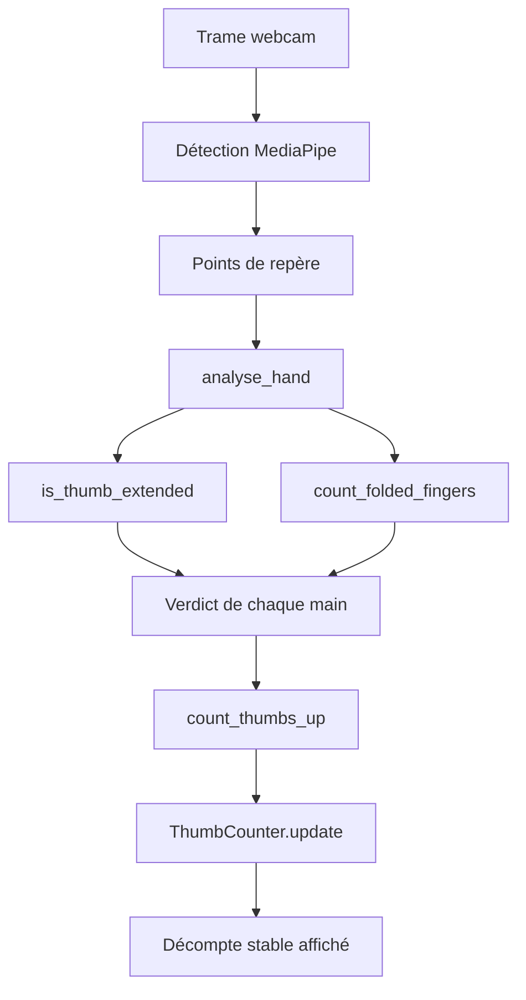

# Devoir 1 - Détection du pouce levé

**Étudiant :** À compléter  
**Cours :** 6MIG841  
**Date :** 8 octobre 2026  
**Github :** https://github.com/Sebastien9999/6MIG841-devoir1  

## 1. Introduction et contexte

L'objectif de ce devoir est de détecter le nombre de mains qui lèvent le pouce
devant une webcam. Le résultat doit rester stable d'une image à l'autre, même
lorsque la détection de la main hésite momentanément.

La solution sépare la plomberie matérielle de la logique de décision. Le programme
principal ouvre la caméra, transmet les images à MediaPipe et affiche le résultat.
Le module `thumb_detector.py` ne dépend pas directement de la webcam : il reçoit
les 21 points de repère d'une main et produit un verdict testable.

Cette séparation permet de tester la décision géométrique sans caméra et de vérifier
les erreurs attendues de manière reproductible.

## 2. Bibliothèques utilisées

- **Python** : langage de développement.
- **OpenCV (`cv2`)** : ouverture de la webcam, lecture des images, affichage de la
  fenêtre et dessin de l'interface.
- **MediaPipe Tasks** : détection et suivi des mains à partir du modèle
  `hand_landmarker.task`.
- **NumPy** : dépendance de l'environnement de traitement d'image.
- **pytest** : exécution des tests automatisés.
- **math** et **collections.deque** : calculs géométriques et historique du filtre
  temporel.

Le modèle MediaPipe est stocké dans `lab1/code/models/hand_landmarker.task`. Il est
chargé par `ihr_ros.hands`, tandis que les paramètres sont centralisés dans
`lab1/code/ihr_config.json`.

## 3. Méthode utilisée

### 3.1 Acquisition et conversion des points

Pour chaque image, OpenCV lit une trame de la webcam. MediaPipe détecte jusqu'à
six mains et fournit 21 points normalisés par main. La fonction `to_pixels` convertit
ces coordonnées en pixels.

La conversion vérifie que la main contient exactement 21 points et que les
dimensions de l'image sont positives. Une entrée invalide provoque une erreur
explicite plutôt qu'un calcul silencieux.

### 3.2 Mesures indépendantes de l'échelle

La taille de la main est mesurée par la distance entre le poignet et la base du
majeur. Les distances de chaque point au poignet sont ensuite calculées.

Cette représentation évite d'utiliser un seuil de distance absolu dépendant de la
distance entre la main et la caméra. Le critère géométrique reste donc valable
lorsque la main est agrandie ou réduite dans l'image.

### 3.3 Décision pour le pouce

Le pouce est considéré comme étendu si ses distances au poignet vérifient :

```text
distance(MCP) < distance(IP) < distance(TIP)
```

Les inégalités sont strictes. La comparaison inclut l'articulation IP afin de
refuser un pouce en crochet dont les extrémités pourraient donner une indication
trompeuse.

L'orientation vers le haut est calculée séparément par l'angle entre le dernier
segment du pouce et le vecteur vertical de l'image. Le seuil utilisé est de
30 degrés.

Enfin, chacun des quatre doigts autres que le pouce est considéré comme replié
lorsque son extrémité est plus proche du poignet que son articulation PIP. Une main
est validée si les quatre doigts sont repliés, si le pouce est étendu et si son
orientation respecte le seuil.

### 3.4 Stabilisation temporelle

Le décompte brut d'une image n'est pas affiché directement. `ThumbCounter` conserve
les trois derniers décomptes par défaut. Une nouvelle valeur n'est publiée que si
la fenêtre est pleine et que ses valeurs sont toutes identiques.

Ainsi, une détection isolée ou une alternance entre deux valeurs ne provoque pas de
changement immédiat du résultat affiché.

## 4. Schéma bloc de la solution


La fonction `thumb_detector.py` reste indépendante de la caméra. Le raccordement
entre MediaPipe et cette logique est effectué dans `detect_thumbs.py`.

## 5. Logigramme des fonctions

Les deux fonctions du devoir sont des feuilles indépendantes du logigramme :



L'implémentation des feuilles a été faite avant la vérification des fonctions qui
les utilisent :

1. `is_thumb_extended` compare les trois distances MCP, IP et TIP.
2. `ThumbCounter.update` ajoute la valeur à sa fenêtre et publie uniquement une
   fenêtre unanime.

## 6. Explications du code

### `is_thumb_extended`

La fonction lit `metrics.distances_to_wrist`, puis retourne directement la
comparaison chaînée :

```python
d = metrics.distances_to_wrist
return d[THUMB_MCP] < d[THUMB_IP] < d[THUMB_TIP]
```

Cette écriture produit un booléen Python et ne contient aucun seuil absolu ni
comparaison d'ordonnées.

### `ThumbCounter.update`

La méthode conserve d'abord la validation existante des valeurs négatives. Elle
ajoute ensuite la valeur à une `deque` de taille maximale `debounce_frames`.
Lorsque la fenêtre est pleine et que toutes ses valeurs sont identiques, la valeur
stable est mise à jour. Dans les autres cas, l'ancienne valeur stable est conservée.

La méthode `reset` vide l'historique et remet le résultat stable à zéro.

## 7. Tests du programme

La suite a été lancée depuis le dossier `dev1` avec l'interpréteur virtuel du
projet :

```powershell
& ..\.venv\Scripts\python.exe -m pytest test -q
```

Résultat obtenu :

```text
42 passed in 0.15s
```

Les tests couvrent notamment :

- les cinq formes canoniques de main ;
- le pouce en crochet ;
- l'invariance à l'échelle `0.6` et `1.5` ;
- l'invariance de la flexion après rotation de 45 degrés ;
- l'orientation juste sous et juste au-dessus du seuil ;
- les mains incomplètes et les dimensions d'image invalides ;
- la publication après une fenêtre unanime ;
- le maintien de l'ancien résultat pendant une alternance ;
- la remise à zéro du compteur.

## 8. Résultats et mesures

La validation automatisée est complète : les 42 tests passent sans échec.

Une validation manuelle a également été effectuée avec la webcam. Le programme
ouvre la fenêtre de détection, reconnaît les pouces levés et affiche le décompte
dans le HUD. Le filtre temporel évite les changements instantanés lorsqu'une
trame est momentanément mal classée.

La configuration utilisée comprend notamment :

| Paramètre | Valeur |
|---|---:|
| Résolution configurée | 640 x 480 |
| Cadence configurée | 30 images/s |
| Nombre maximal de mains | 6 |
| Seuil d'orientation du pouce | 30 degrés |
| Doigts repliés requis | 4 |
| Fenêtre de stabilisation | 3 trames |
| Taille minimale de main | 40 pixels |

La cadence réelle n'a pas été relevée numériquement dans ce rapport ; l'interface
l'affiche en temps réel et pourrait être mesurée lors d'une séance dédiée.

## 9. Discussion et limites

La méthode est plus robuste qu'un seuil fixe en coordonnées normalisées et qu'une
simple comparaison des ordonnées. Elle reste toutefois dépendante de la qualité
de la détection MediaPipe et de la visibilité de la main.

Les principales limites sont les suivantes :

- une main trop petite est rejetée car ses mesures deviennent peu fiables ;
- une occultation ou une main coupée peut empêcher la détection des 21 points ;
- l'orientation « vers le haut » est volontairement définie dans le repère de
  l'image et ne correspond pas à une rotation arbitraire de toute la main ;
- le filtre temporel introduit un retard de quelques trames ;
- une caméra occupée par une autre application empêche l'acquisition ;
- l'éclairage, le contraste et la position de la main peuvent influencer MediaPipe.

Le seuil de 30 degrés, la taille minimale et la fenêtre de trois trames sont des
paramètres de configuration et peuvent être ajustés après des essais avec
différentes caméras et différents utilisateurs.

## 10. Conclusion

Le Devoir 1 réalise le comptage stable des pouces levés à partir d'une webcam.
La solution sépare correctement l'acquisition, l'analyse géométrique et le
filtrage temporel. Les deux fonctions demandées ont été implémentées conformément
à la spécification et les 42 tests automatisés passent.

La validation avec la webcam confirme que le programme se lance et que les pouces
levés sont détectés. La structure retenue permet également de tester la logique
sans matériel et de faire évoluer les paramètres sans modifier le code de décision.

## 11. Références et hygiène

- Énoncé du Devoir 1, fichier `enonce.md`.
- Code source du projet, notamment `code/detect_thumbs.py` et
  `code/thumb_detector.py`.
- Documentation officielle MediaPipe Tasks Hand Landmarker.
- Documentation officielle OpenCV-Python.
- Documentation officielle pytest.

Le code n'utilise pas de données personnelles ni de réseau pendant l'exécution
normale après téléchargement du modèle. Les tests sont reproductibles, les
paramètres sont centralisés dans `ihr_config.json`, et les fichiers de test n'ont
pas été modifiés.
